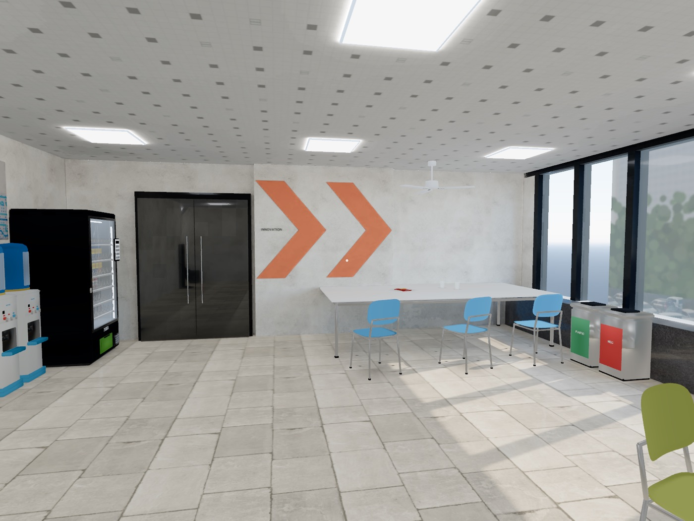
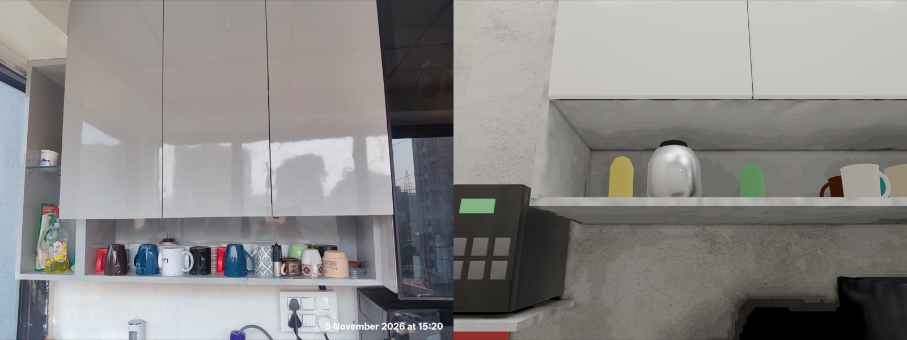
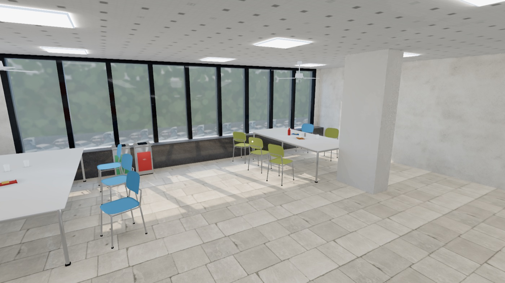

# 🎮 CCTech: The Game

**What if you could walk through the CCTech office from anywhere, right in your web browser?**

Grab a coffee at the Tata Bistro machine. Flip the pantry lights. Toss a mug across the room (please don't do that in real life). Get a snack from the vending machine and sit down with it.

That's the idea: **turn the whole CCTech office into a game**, built so true to life that colleagues say *"wait, that's our pantry!"* within a minute.

> **🚧 Work in progress.** We're just getting started. Only the **4th-floor pantry and seating area** is built so far. The rest of the office is waiting to be added, and **you can help build it.**

<p align="center">
  
</p>

## Real photo vs the game

Every corner is built by matching it against real photos of the office.

<p align="center">
  
  <br><em>Left: real photo. Right: the game.</em>
</p>

## The big plan

| Stage | What | Status |
|---|---|---|
| 1 | 4th-floor pantry and seating area | 🟡 Almost there: fine-tuning the look |
| 2 | Desks and work areas | ⚪ Not started |
| 3 | Meeting rooms | ⚪ Not started |
| 4 | The rest of the 4th floor | ⚪ Not started |
| 5 | Ride the lift to other floors | ⚪ Not started |
| 6 | Colleagues walking around, mini-games, playing together | ⚪ Ideas for later |

## What you can do today

- 🚶 Walk around the pantry and seating area
- ☕ Use the vending machine and fill a glass at the water cooler
- 💡 Flip the light switches and watch the room change
- 🫳 Pick things up, carry them around, drop them or throw them
- 🪑 Sit on the chairs
- 👀 Point at things to see their name and a little story about them
- 🔊 Real-sounding sounds as you go

<p align="center">
  
</p>

## Controls

| Key | What it does |
|---|---|
| W A S D | Walk |
| Mouse | Look around (click the game first) |
| Shift | Walk faster |
| E | Use something (switch, vending machine, cooler, chair) |
| Left click | Pick up / drop |
| Right click or Q | Throw what you're holding |
| M | Sound on / off |
| Esc | Settings |

## Play it on your computer

You need [Node.js](https://nodejs.org) and [pnpm](https://pnpm.io).

```sh
pnpm install
pnpm dev
```

Then open http://localhost:5173 in Chrome.

- Chrome works best. If the game won't start on an older computer, add `?webgl=1` to the end of the address.
- The small box in the top-left corner shows how smoothly it's running.

## 🙌 Join in

This is a fun side project, and the office is big. There's room for everyone:

- **📸 Take photos.** Pictures of corners that aren't built yet, plus close-ups of signs, labels and posters, are the most useful thing of all.
- **🧱 Build a room.** Pick an area and help recreate it.
- **🐞 Spot what's wrong.** If something doesn't look like the real office, tell us.
- **💡 Bring ideas.** Easter eggs, inside jokes, mini-games.

How to start:

1. Look at the to-do list in `backlog/tasks/`.
2. Pick something, or suggest your own idea.
3. Make your changes on your own branch and open a pull request (a request to add your changes).

## Still being polished

- Making each corner match the photos even more closely (coffee machine, sink, signs).
- Smoothness: walking is a steady 60 frames per second, with a rare short hitch.
- Not yet tested properly in Safari.

## How it's put together (for developers)

- `src/`: the game itself (TypeScript, Three.js for 3D, Rapier for physics).
- `blender/`: scripts that build the 3D models and work out the lighting in Blender.
- `public/`: the finished models, lighting, textures and sounds the game loads.
- `references/`: real office photos and video used to match the look.
- `scripts/`: automatic checks (screenshots next to real photos, smoothness and walking tests).
- `docs/`: notes, decisions and research.

Handy check commands:

```sh
pnpm typecheck          # check the code for mistakes
pnpm check:match        # game screenshots next to the real photos
pnpm check:walk         # walls and furniture block you correctly
pnpm check:fps --headed # how smoothly it runs
```
